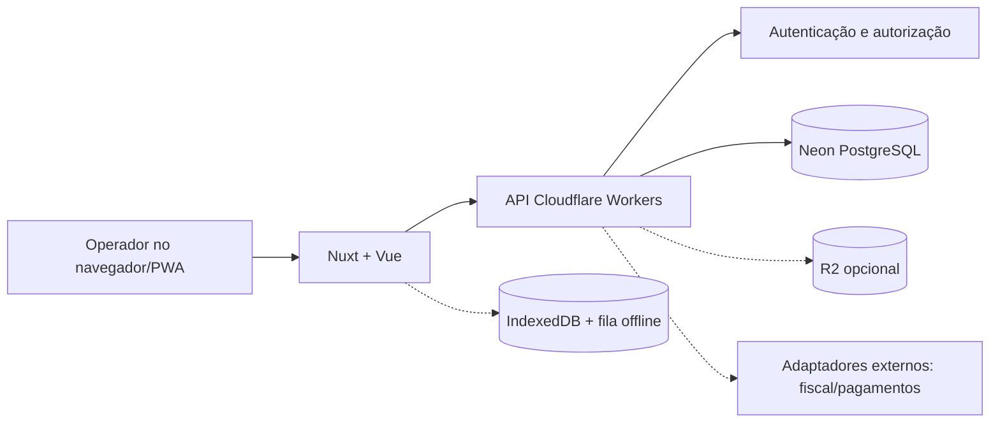

# 03 — Arquitetura

> **Classificações:** **DEFINIDO** = decisão explicitamente estabelecida; **PLANEJADO** = intenção ainda não implementada; **A VALIDAR** = depende de levantamento, prova técnica ou avaliação especializada.
> **Estado:** documentação inicial, não constitui evidência de implementação.

## Visão lógica proposta

## Responsabilidades
- **Frontend:** UX, cache de interface, fila local e feedback de sincronização; não é autoridade de permissões.
- **API:** autenticação, tenant, autorização, validação, idempotência, transações e auditoria.
- **PostgreSQL:** dados transacionais, integridade e índices por estabelecimento.
- **Integrações:** contratos isolados, falhas tratadas sem comprometer o núcleo.

## Fluxo de venda
Requisição com identificador único → validar sessão/tenant/caixa → persistir venda, itens, pagamentos e movimentos em transação → responder resultado idempotente. **A VALIDAR:** regra de estoque negativo, pagamento e fiscal.

## Offline
Service Worker para assets, IndexedDB para operações permitidas e fila com estados pendente/sincronizado/falha. Nunca apresentar venda local como confirmada pelo servidor. Pagamento externo e emissão fiscal não são automaticamente offline.

## Decisões pendentes
Compatibilidade Nuxt/Workers, driver Neon, ORM, auth, connection pooling, observabilidade e deploy. Ver `09-DECISOES-TECNICAS.md` e `17-INTEGRACOES.md`.
