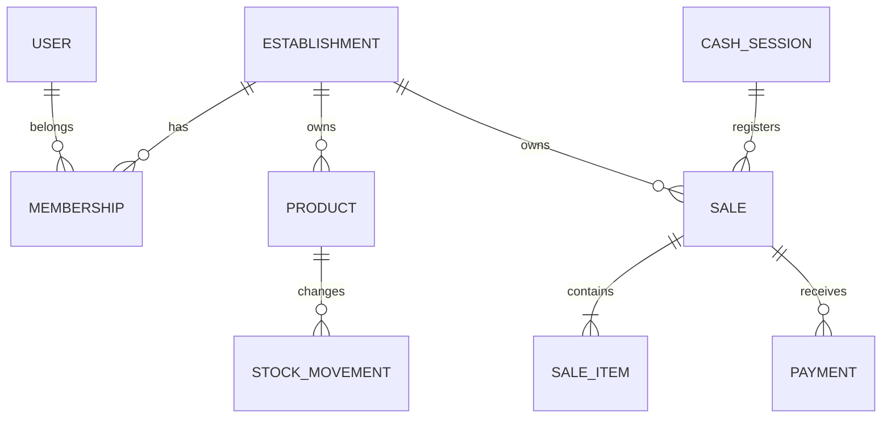

# 04 — Modelo de dados preliminar

> **Classificações:** **DEFINIDO** = decisão explicitamente estabelecida; **PLANEJADO** = intenção ainda não implementada; **A VALIDAR** = depende de levantamento, prova técnica ou avaliação especializada.
> **Estado:** documentação inicial, não constitui evidência de implementação.

**PLANEJADO:** proposta conceitual, não esquema aprovado ou migration executada.

## Entidades candidatas
| Entidade | Campos ilustrativos | Relação |
|---|---|---|
| establishment | id, name, status | raiz do tenant |
| user | id, auth_subject | identidade |
| membership | user_id, establishment_id, role | vínculo e autorização |
| product | id, establishment_id, sku, barcode, price | catálogo |
| category | id, establishment_id, name | classificação |
| supplier | id, establishment_id, name | fornecedor |
| stock_movement | id, establishment_id, product_id, quantity_delta, reason | livro de movimentos |
| cash_session | id, establishment_id, operator_id, opened_at, closed_at | turno de caixa |
| sale | id, establishment_id, cash_session_id, client_operation_id, status | venda |
| sale_item | sale_id, product_id, quantity, unit_price | item histórico |
| payment | sale_id, method, amount, status | pagamento |
| audit_event | establishment_id, actor_id, action, timestamp | rastreabilidade |
| sync_operation | establishment_id, client_operation_id, status | deduplicação |

## Relações

## Invariantes propostas
Chaves estrangeiras, valores monetários em decimal/unidades menores, restrições de unicidade por tenant e `(establishment_id, client_operation_id)` único para idempotência. Consultas sempre filtradas por tenant validado no servidor; considerar RLS como defesa adicional, não substituto.

**A VALIDAR:** unidades/peso, tributos, lotes, custo médio, devoluções, retenção, migrações e índices. Ver `06-REGRAS-DE-NEGOCIO.md`.
