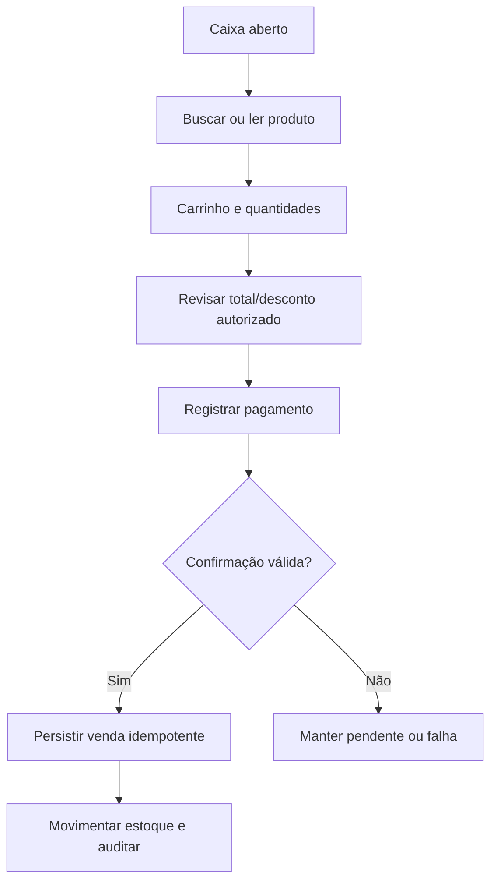

# 13 — Fluxos operacionais

> **Classificações:** **DEFINIDO** = decisão explicitamente estabelecida; **PLANEJADO** = intenção ainda não implementada; **A VALIDAR** = depende de levantamento, prova técnica ou avaliação especializada.
> **Estado:** documentação inicial, não constitui evidência de implementação.

Todos os fluxos abaixo são **PLANEJADOS** e exigem observação/aceite do piloto.

## Caixa
Abertura: autenticar operador → selecionar estabelecimento → registrar saldo inicial → criar sessão. Sangria/suprimento: informar valor e motivo → verificar permissão → lançar movimento auditado. Fechamento: conferir recebimentos → apurar diferenças → registrar responsável → encerrar sessão. **A VALIDAR:** aprovação de diferenças e turno único.

## Venda

## Exceções
Cancelamento antes da confirmação: descartar carrinho. Cancelamento de venda confirmada, estorno e devolução: registrar evento compensatório com autorização e referência à venda original; regras fiscais e financeiras **A VALIDAR**.

## Estoque
Entrada: identificar origem/fornecedor → conferir itens → registrar movimento. Ajuste: exigir motivo e responsável → registrar delta auditável. Não editar histórico para esconder divergências.

## Offline
Mostrar operação pendente, sincronizada ou falha; impedir que estado local seja apresentado como venda confirmada. Ver `06-REGRAS-DE-NEGOCIO.md` e `17-INTEGRACOES.md`.
